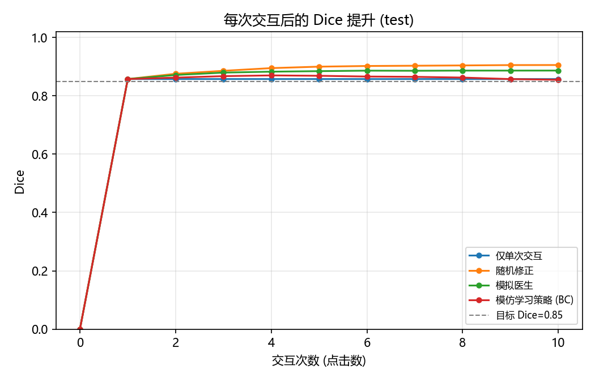
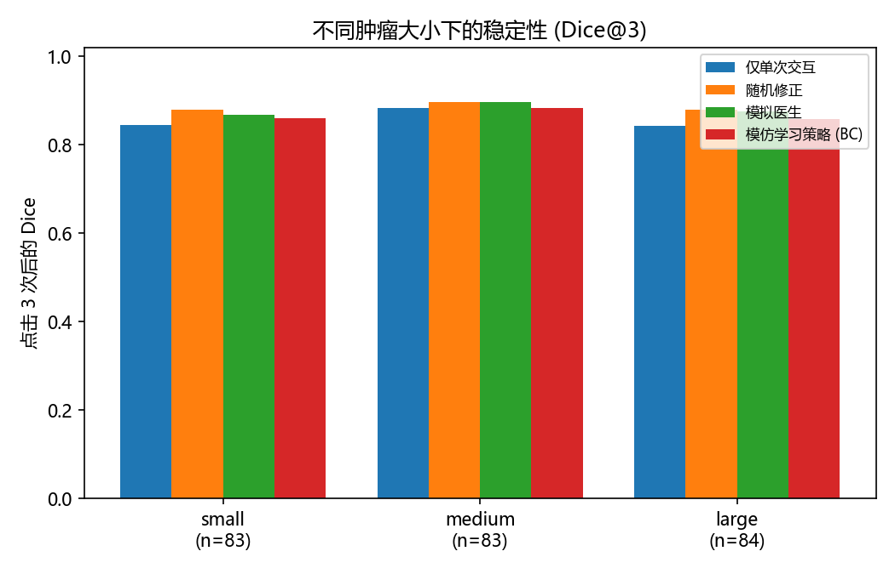
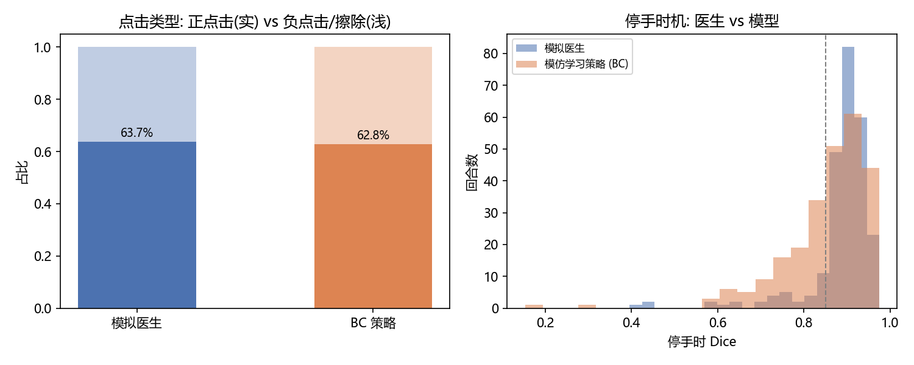
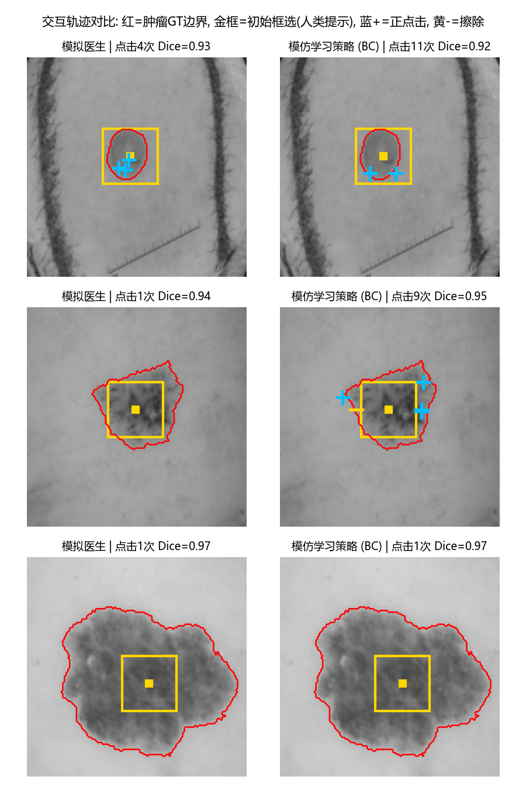

# MedSAM2 + 交互式肿瘤分割模仿学习 — 评估报告

> 测试回合: 250; 目标 Dice ≥ 0.85; 最多交互 10 次; 初始交互 = 框选 (真实内镜标注工作流); ATTC 未达标按 11 次计惩罚。

## 1. 达到目标 Dice 所需点击次数 (ATTC)

| 策略 | 平均点击(含惩罚) | 成功者中位点击 | 成功率 [95% CI] | 平均点击数 |
|---|---|---|---|---|
| 仅单次交互 | 3.92 | 1.0 | 70.8% [65.2%, 76.4%] | 1.00 |
| 随机修正 | 2.04 | 1.0 | 97.6% [95.6%, 99.2%] | 2.84 |
| 模拟医生 | 2.54 | 1.0 | 90.4% [86.8%, 94.0%] | 3.31 |
| 模仿学习策略 (BC) | 3.18 | 1.0 | 80.4% [75.2%, 85.2%] | 5.95 |

## 2. 每次交互后的 Dice 提升

| 策略 | Dice@1 | Dice@3 | Dice@5 | 平均边际增益/次 | 交互后平均Dice(AUC) |
|---|---|---|---|---|---|
| 仅单次交互 | 0.858 | 0.858 | 0.858 | 0.086 | 0.858 |
| 随机修正 | 0.858 | 0.886 | 0.900 | 0.091 | 0.894 |
| 模拟医生 | 0.858 | 0.880 | 0.885 | 0.089 | 0.881 |
| 模仿学习策略 (BC) | 0.858 | 0.868 | 0.869 | 0.086 | 0.863 |

## 3. 不同肿瘤大小下的稳定性

(按肿瘤面积三分位分箱: q33=0.0521, q66=0.1797)

| 策略 | small Dice@3 / ATTC | medium Dice@3 / ATTC | large Dice@3 / ATTC |
|---|---|---|---|
| 仅单次交互 | 0.846 / 4.98 | 0.884 / 3.29 | 0.844 / 3.50 |
| 随机修正 | 0.880 / 2.43 | 0.898 / 1.70 | 0.880 / 2.00 |
| 模拟医生 | 0.868 / 3.42 | 0.896 / 1.90 | 0.875 / 2.29 |
| 模仿学习策略 (BC) | 0.861 / 4.10 | 0.884 / 2.58 | 0.858 / 2.86 |

## 4. 医生与模型的交互策略差异

| 策略 | 正点击占比 | 框选占比 | 点击离肿瘤质心距离(等效半径) | 停手Dice标准差 | 停手Dice均值 |
|---|---|---|---|---|---|
| 仅单次交互 | 0.0% | 100.0% | 0.16 | 0.119 | 0.858 |
| 随机修正 | 51.6% | 35.2% | 0.70 | 0.033 | 0.906 |
| 模拟医生 | 63.7% | 30.2% | 0.55 | 0.081 | 0.887 |
| 模仿学习策略 (BC) | 62.8% | 16.8% | 0.77 | 0.100 | 0.855 |

## 5. 轨迹可视化

