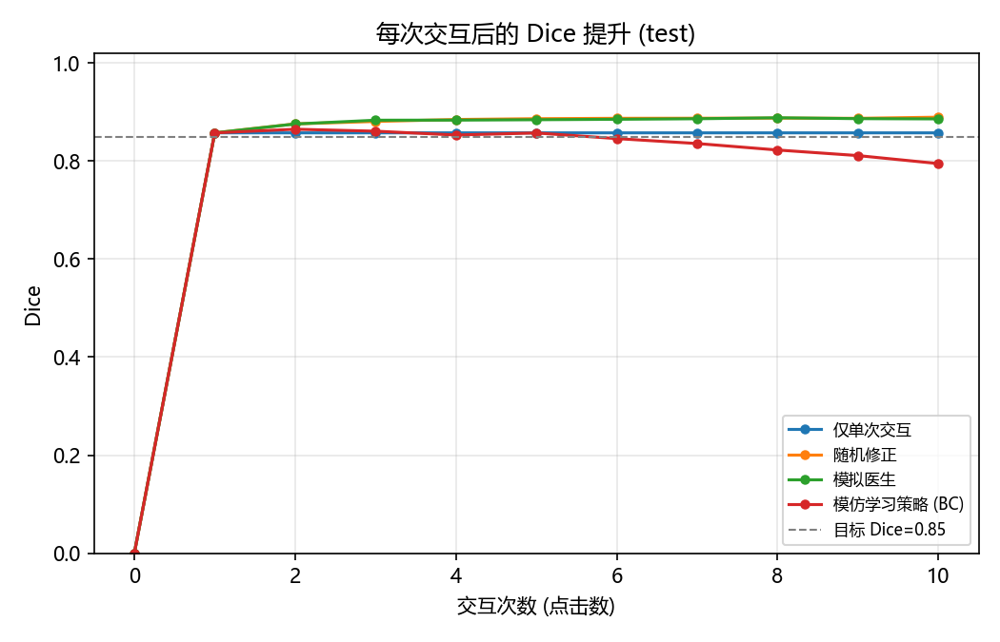
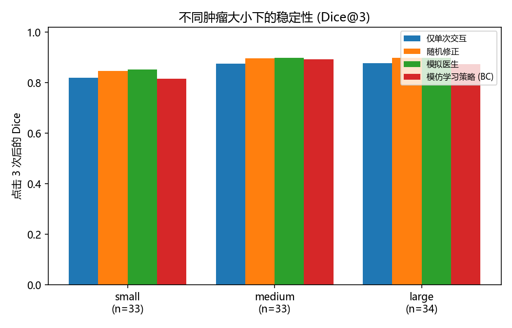
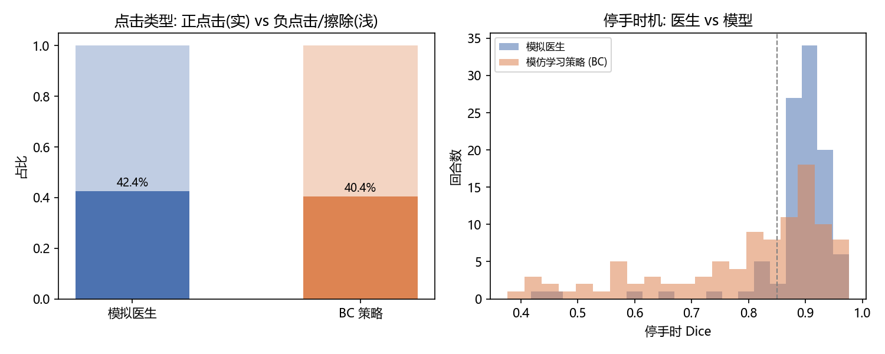
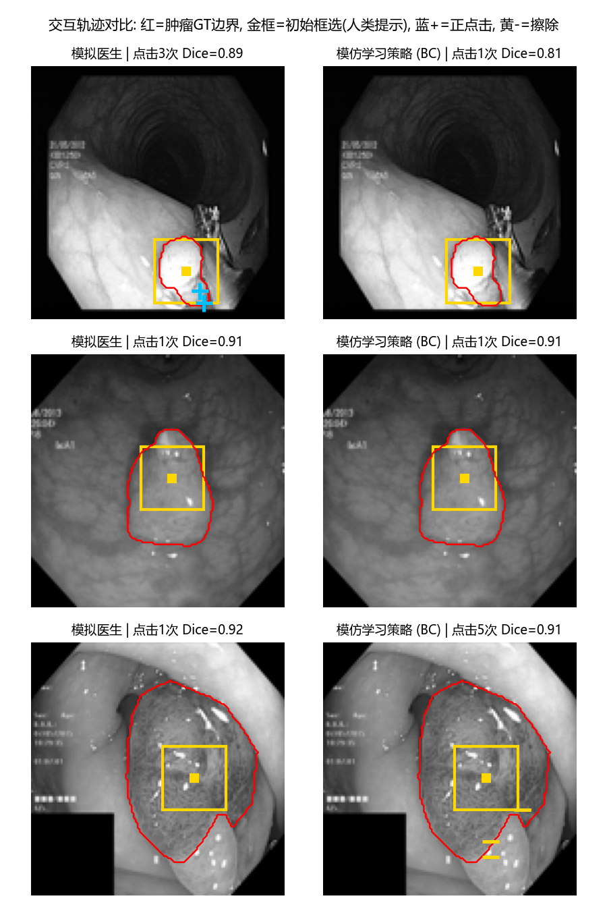

# MedSAM2 + 交互式肿瘤分割模仿学习 — 评估报告

> 测试回合: 100; 目标 Dice ≥ 0.85; 最多交互 10 次; 初始交互 = 框选 (真实内镜标注工作流); ATTC 未达标按 11 次计惩罚。

## 1. 达到目标 Dice 所需点击次数 (ATTC)

| 策略 | 平均点击(含惩罚) | 成功者中位点击 | 成功率 [95% CI] | 平均点击数 |
|---|---|---|---|---|
| 仅单次交互 | 4.30 | 1.0 | 67.0% [58.0%, 76.0%] | 1.00 |
| 随机修正 | 2.51 | 1.0 | 90.0% [84.0%, 95.0%] | 3.15 |
| 模拟医生 | 2.45 | 1.0 | 91.0% [85.0%, 96.0%] | 3.05 |
| 模仿学习策略 (BC) | 3.20 | 1.0 | 81.0% [73.0%, 88.0%] | 6.69 |

## 2. 每次交互后的 Dice 提升

| 策略 | Dice@1 | Dice@3 | Dice@5 | 平均边际增益/次 | 交互后平均Dice(AUC) |
|---|---|---|---|---|---|
| 仅单次交互 | 0.858 | 0.858 | 0.858 | 0.086 | 0.858 |
| 随机修正 | 0.858 | 0.881 | 0.887 | 0.089 | 0.883 |
| 模拟医生 | 0.858 | 0.883 | 0.884 | 0.089 | 0.882 |
| 模仿学习策略 (BC) | 0.858 | 0.861 | 0.857 | 0.079 | 0.840 |

## 3. 不同肿瘤大小下的稳定性

(按肿瘤面积三分位分箱: q33=0.0731, q66=0.1669)

| 策略 | small Dice@3 / ATTC | medium Dice@3 / ATTC | large Dice@3 / ATTC |
|---|---|---|---|
| 仅单次交互 | 0.819 / 5.24 | 0.875 / 4.33 | 0.877 / 3.35 |
| 随机修正 | 0.847 / 3.33 | 0.897 / 2.15 | 0.898 / 2.06 |
| 模拟医生 | 0.852 / 3.30 | 0.899 / 2.03 | 0.899 / 2.03 |
| 模仿学习策略 (BC) | 0.815 / 4.70 | 0.894 / 2.33 | 0.873 / 2.59 |

## 4. 医生与模型的交互策略差异

| 策略 | 正点击占比 | 框选占比 | 点击离肿瘤质心距离(等效半径) | 停手Dice标准差 | 停手Dice均值 |
|---|---|---|---|---|---|
| 仅单次交互 | 0.0% | 100.0% | 0.16 | 0.096 | 0.858 |
| 随机修正 | 38.1% | 31.7% | 0.83 | 0.075 | 0.890 |
| 模拟医生 | 42.4% | 32.8% | 0.67 | 0.083 | 0.886 |
| 模仿学习策略 (BC) | 40.4% | 14.9% | 0.71 | 0.155 | 0.795 |

## 5. 轨迹可视化

