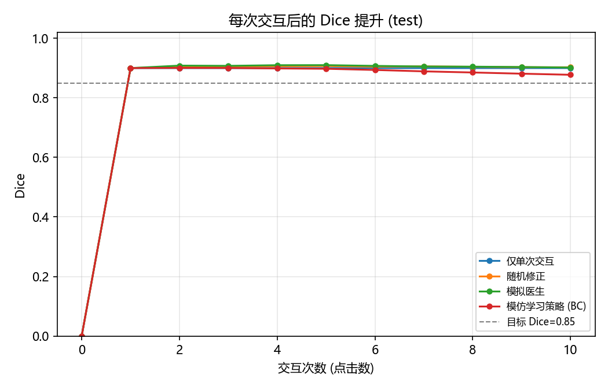
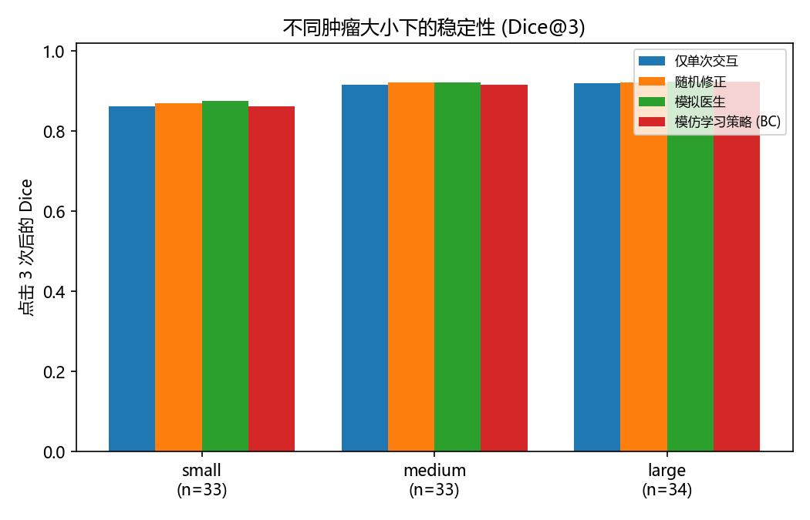
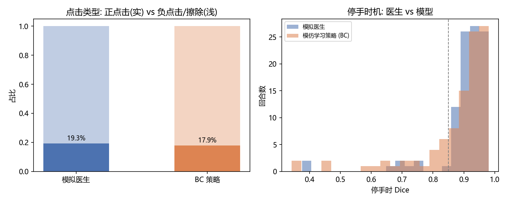
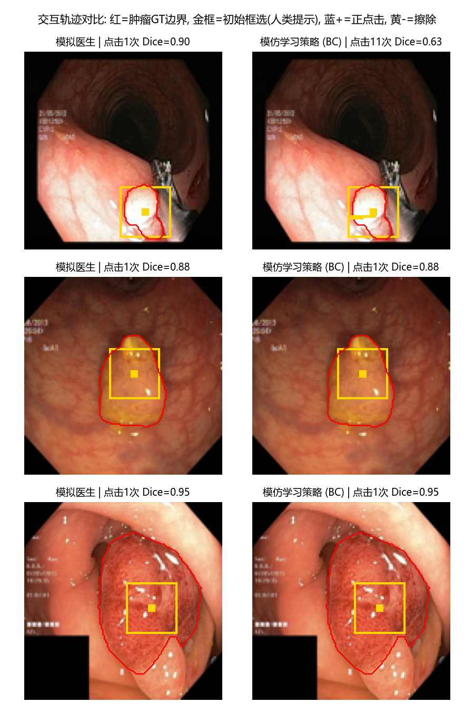

# MedSAM2 + 交互式肿瘤分割模仿学习 — 评估报告

> 测试回合: 100; 目标 Dice ≥ 0.85; 最多交互 10 次; 初始交互 = 框选 (真实内镜标注工作流); ATTC 未达标按 11 次计惩罚。

## 1. 达到目标 Dice 所需点击次数 (ATTC)

| 策略 | 平均点击(含惩罚) | 成功者中位点击 | 成功率 [95% CI] | 平均点击数 |
|---|---|---|---|---|
| 仅单次交互 | 2.70 | 1.0 | 83.0% [75.0%, 90.0%] | 1.00 |
| 随机修正 | 1.97 | 1.0 | 92.0% [86.0%, 97.0%] | 2.33 |
| 模拟医生 | 1.97 | 1.0 | 92.0% [86.0%, 97.0%] | 2.14 |
| 模仿学习策略 (BC) | 2.34 | 1.0 | 87.0% [80.0%, 93.0%] | 3.35 |

## 2. 每次交互后的 Dice 提升

| 策略 | Dice@1 | Dice@3 | Dice@5 | 平均边际增益/次 | 交互后平均Dice(AUC) |
|---|---|---|---|---|---|
| 仅单次交互 | 0.900 | 0.900 | 0.900 | 0.090 | 0.900 |
| 随机修正 | 0.900 | 0.905 | 0.907 | 0.090 | 0.904 |
| 模拟医生 | 0.900 | 0.908 | 0.910 | 0.090 | 0.906 |
| 模仿学习策略 (BC) | 0.900 | 0.900 | 0.898 | 0.088 | 0.892 |

## 3. 不同肿瘤大小下的稳定性

(按肿瘤面积三分位分箱: q33=0.0731, q66=0.1669)

| 策略 | small Dice@3 / ATTC | medium Dice@3 / ATTC | large Dice@3 / ATTC |
|---|---|---|---|
| 仅单次交互 | 0.863 / 3.73 | 0.916 / 1.91 | 0.920 / 2.47 |
| 随机修正 | 0.871 / 2.61 | 0.922 / 1.64 | 0.922 / 1.68 |
| 模拟医生 | 0.877 / 2.61 | 0.922 / 1.64 | 0.923 / 1.68 |
| 模仿学习策略 (BC) | 0.862 / 3.73 | 0.916 / 1.64 | 0.923 / 1.68 |

## 4. 医生与模型的交互策略差异

| 策略 | 正点击占比 | 框选占比 | 点击离肿瘤质心距离(等效半径) | 停手Dice标准差 | 停手Dice均值 |
|---|---|---|---|---|---|
| 仅单次交互 | 0.0% | 100.0% | 0.16 | 0.077 | 0.900 |
| 随机修正 | 20.3% | 42.9% | 0.74 | 0.090 | 0.903 |
| 模拟医生 | 19.3% | 46.7% | 0.60 | 0.095 | 0.902 |
| 模仿学习策略 (BC) | 17.9% | 29.9% | 0.54 | 0.122 | 0.878 |

## 5. 轨迹可视化

